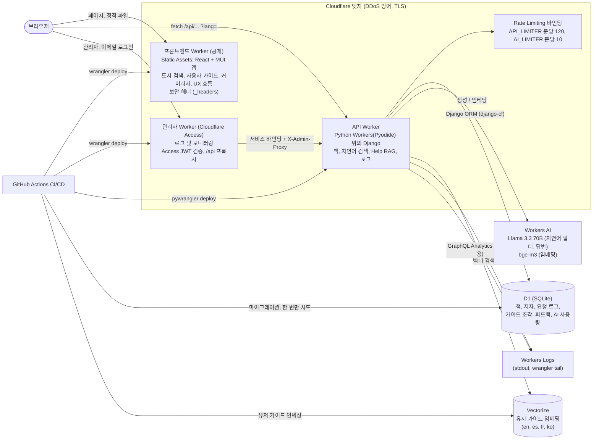
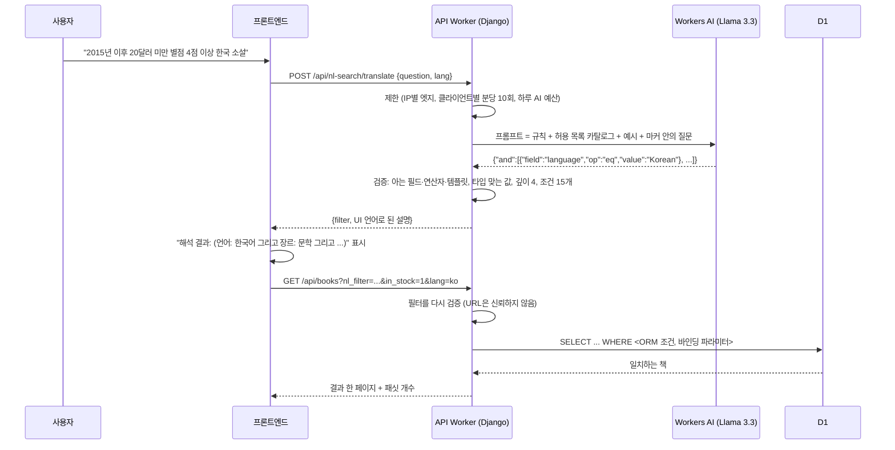
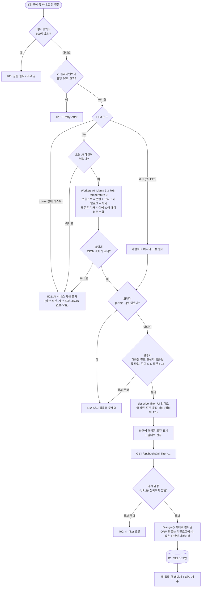
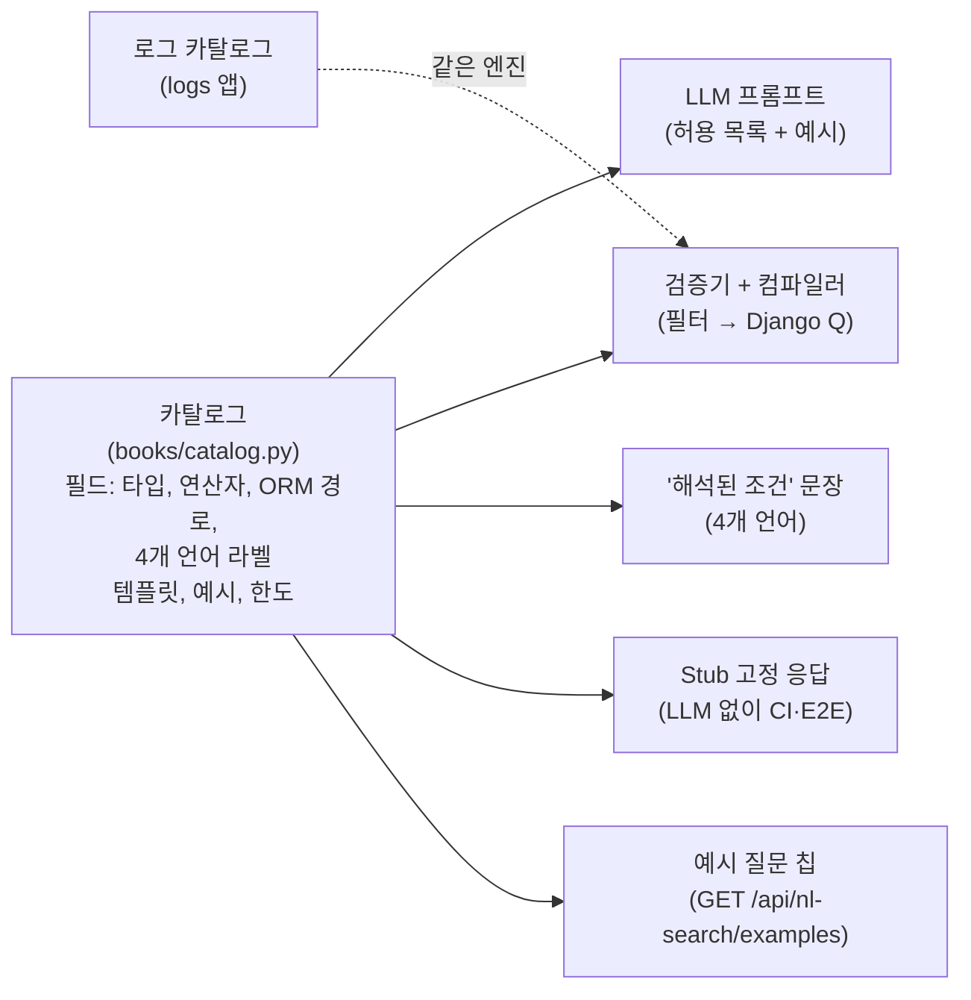
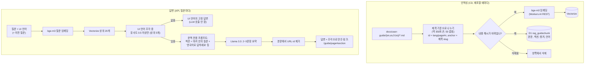
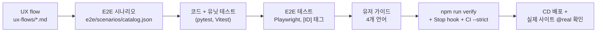

# BookFinder (한국어)

> 원본은 [README.md](README.md)(영문)입니다.

**자연어로 질문**하면("2015년 이후 20달러 미만 별점 4점 이상 한국 소설") 조건에 정확히 맞는 책을 찾아 주고,
서비스 사용법은 자체 유저 가이드를 바탕으로 **Help 도우미**(RAG)가 알려 주는 도서 검색 서비스예요. 모든 것이
Cloudflare(Workers, D1, Vectorize, Workers AI) 위에서 돌고, 영어·스페인어·프랑스어·한국어를 지원해요.

| | |
|---|---|
| 서비스 | https://bookfinder.kookastudios.workers.dev |
| API 상태 | https://bookfinder-api.kookastudios.workers.dev/api/health |
| 테스트 커버리지 | https://bookfinder.kookastudios.workers.dev/coverage |
| UX flow | https://bookfinder.kookastudios.workers.dev/ux-flows/ |

> **이 저장소에서 일하는 AI 에이전트와 LLM은 무엇이든 바꾸기 전에 반드시 [AGENTS.md](AGENTS.md)를 읽어야 해요**
> (한국어: [AGENTS.ko.md](AGENTS.ko.md)). 반드시 따라야 하는 작업 프로세스예요. 기능 단위로 작업하고, 변경할 때마다
> UX flow, E2E 시나리오, E2E 테스트, 유닛 테스트, 유저 가이드(4개 언어), 검증을 함께 진행해요. Claude Code는 `CLAUDE.md`로
> 자동으로 읽고, Stop hook과 CI가 지키는지 검사해요. 결정 사항·설정·운영은 [docs/project/DECISIONS.ko.md](docs/project/DECISIONS.ko.md)에 있어요.

---

## 왜 만들었나

BookFinder는 2026-10-12에 1시간짜리 "AI로 웹앱 만들기" 라이브 인터뷰의 기준 프로젝트로 만들었어요. 명세 패키지
(`poc_samples.zip`: UX flow, E2E 시나리오 카탈로그, 자연어 검색 설계, RAG 프로토타입)를 바탕으로 했고, 세 가지를 보여 줘요.

1. **처음부터 안전하게 설계한 AI 기능.** LLM은 SQL을 쓰지 않고 답을 지어내지 않아요. 자연어는 검증된 필터가 되고,
   Help 도우미는 링크로 확인할 수 있는 문서에서만 답해요.
2. **서버리스 스택 위의 완전한 제품.** 프론트엔드, API, 데이터베이스, 벡터 검색, LLM이 모두 Cloudflare 계정 하나에서 돌고,
   테스트를 통과한 push마다 CI/CD가 배포해요.
3. **AI와 함께 일하는 개발 방법.** 기능마다 UX flow, E2E 시나리오와 테스트, 유닛 테스트, 사용자 문서가 함께 움직이고,
   에이전트가 따르고 CI가 확인하는 규칙([AGENTS.md](AGENTS.md))으로 맞춰져요. 같은 구성을 템플릿
   [cd-jung/fullstack-template](https://github.com/cd-jung/fullstack-template)에서 다시 쓸 수 있어요.

## 기능

| 기능 | 동작 방식 |
|---|---|
| 키워드·필터 검색 | 생성한 책 1만 권(결정적). 제목·저자·ISBN·출판사·설명 키워드 검색, 장르·저자·연도·언어·형식·재고·평점·가격 필터, 칩, 정렬, 페이지, 격자/목록, URL 상태 |
| 자연어 검색 (AI) | 질문 → LLM → JSON 필터 → 허용 목록으로 검증 → Django ORM 쿼리. "해석 결과"에 모든 조건을 보여 주고, "필터로 편집"으로 필터 패널에 옮겨요 |
| 책 정보 | 형식별 가격과 재고, 비슷한 책, ISBN·링크 복사, 딥 링크 |
| Help 도우미 (RAG) | "어떻게 해요?" 질문에 유저 가이드만으로, 사용자의 언어로, 정확한 섹션 링크와 함께 답해요 |
| 유저 가이드 | 4개 언어로 7페이지. 같은 Markdown 파일이 앱 안의 가이드이자 **RAG 원본**이에요 |
| 로그 및 모니터링 | 모든 API 요청을 기록. 대시보드(요청 수, 5xx 비율, p95, 4xx, 시간별)와 자연어 로그 검색 |
| 커버리지 | 유닛 테스트 커버리지, E2E 시나리오 커버리지, UX flow 그래프를 앱 안에서 보여 줘요 |
| 다국어 | English, Español, Français, 한국어로 UI 문구, 유저 가이드, Help, "해석 결과", 카탈로그 값을 제공 |

## 아키텍처



| 구성 요소 | Cloudflare 서비스 | 구현 |
|---|---|---|
| 프론트엔드 | **Workers Static Assets** | React + TypeScript + Vite, MUI 컴포넌트, react-router, react-i18next. 정적 파일만 있어서 요청이 무료이고 코드가 돌지 않아요 |
| API | **Python Workers** | `django-cf`로 Pyodide 위에서 도는 Django(WSGI). 앱: `books`(카탈로그), `nlsearch`(자연어 → 필터 → ORM), `rag`(Help), `logs`(요청 로그, 대시보드), `core`(LLM 게이트웨이, 제한, CORS) |
| 데이터베이스 | **D1** | SQLite 위의 Django ORM. 넓은 `books_book` 테이블 하나(다중 값은 `\|a\|b\|` 토큰, D1 쓰기 한도를 고려), 요청 로그, 언어별 가이드 조각 |
| LLM | **Workers AI** `@cf/meta/llama-3.3-70b-instruct-fp8-fast` | 질문을 필터로 바꾸고 Help 요약을 써요. temperature 0, API 키 없이 바인딩으로 호출 |
| 임베딩 | **Workers AI** `@cf/baai/bge-m3` | 유저 가이드와 질문을 다국어 1,024차원 벡터로 |
| 벡터 DB | **Vectorize** | 4개 언어 유저 가이드 섹션 전체의 코사인 인덱스 |
| 남용 방지 | **Rate Limiting 바인딩** | DB 작업 전에 엣지에서 IP별 제한 |
| 배포 | GitHub Actions + `wrangler` | 린트 → 유닛 → 정합성 → E2E → 빌드, 그다음 D1 마이그레이션, 시드, 배포, 가이드 인덱싱, 스모크·실제 모델 테스트 |

모든 LLM·임베딩·벡터 호출은 모듈 하나(`backend/src/core/llm.py`)를 거치고, 모드는 세 가지예요: `real`(Workers AI),
`stub`(CI와 E2E용 결정적 픽스처), `down`(장애 테스트).

## 자연어 검색: 질문 → 검증된 필터 → ORM

LLM은 데이터베이스 사용자가 아니라 **작은 JSON 필터 언어로 옮기는 번역기**로만 써요. 설계는 명세의
`nl-search-implementation` 가이드에서 왔어요.



- **카탈로그가 유일한 기준** (`backend/src/books/catalog.py`): 검색 가능한 필드마다 타입, 연산자, ORM 경로, 4개 언어 라벨이
  있어요. 추가 로직이 필요한 조건은 서버 쪽 **템플릿**(수상작, 시리즈 도서, 신간, 저자 수, 비슷한 책)으로 처리해요. 프롬프트,
  검증기, "해석 결과" 문장, stub 픽스처가 모두 여기서 만들어져요.
- **안전장치:** 필드 이름과 ORM 경로는 카탈로그에서만 오고, 값은 바인딩 파라미터예요. 필터는 해석할 때 **그리고** 목록을
  요청할 때마다 검증하고, 쿼리는 SELECT만 해요. 카탈로그로 표현할 수 없는 질문은 추측 대신 "다르게 질문해 주세요"(422)로 답해요.
- **설명 가능:** "해석 결과"는 필터에서 1:1로 만들어서 사용자가 조건을 하나하나 확인할 수 있고, "필터로 편집"으로 일반 필터로 바꿀 수 있어요.

### 전체 처리 흐름 (모든 실패 경로 포함)



### 필터 언어

모델은 아래의 작은 문법으로만 답할 수 있어요 (프롬프트에 들어 있고, 검증기가 강제합니다).

```text
node      := {"and": [node, ...]} | {"or": [node, ...]} | {"not": node} | condition | template
condition := {"field": <필드 이름>, "op": <연산자>, "value": <값>}
template  := {"template": <템플릿 이름>, "params": {...}}
```

| 필드 타입 | 허용 연산자 |
|---|---|
| string | `eq`, `icontains`, `in`, `isnull` |
| number, date | `eq`, `gt`, `gte`, `lt`, `lte`, `isnull` |
| datetime | `gt`, `gte`, `lt`, `lte`, `isnull` |
| enum | `eq`, `in` |
| boolean | `eq` |

예: *"2015년 이후 20달러 미만 별점 4점 이상 한국 소설"* (영어·스페인어·프랑스어로 물어도 같음)은 이렇게 바뀝니다.

```json
{
  "and": [
    {"field": "language",       "op": "eq",  "value": "Korean"},
    {"field": "genre",          "op": "eq",  "value": "literary-fiction"},
    {"field": "published_year", "op": "gt",  "value": 2015},
    {"field": "price",          "op": "lt",  "value": 20},
    {"field": "rating",         "op": "gte", "value": 4}
  ]
}
```

모델은 테이블 이름도 SQL도 보지 못하고, 카탈로그에서 고르기만 합니다. 모델이 지어낸 것(없는 필드, 잘못된 연산자,
숫자 자리에 문자열, 너무 깊은 중첩)은 쿼리를 만들기 전에 모두 거부됩니다.

### 카탈로그 하나가 모든 것을 만든다



검색 필드를 하나 추가하려면 카탈로그 항목 하나만 추가하면 됩니다. 프롬프트, 검증, 설명 문장, 테스트가 모두 따라옵니다.
Logs & Monitoring 페이지도 자체 카탈로그로 같은 엔진을 써서, 관리자가 요청 로그를 자연어로 검색할 수 있습니다.

### 상태 코드

| 코드 | 언제 | 사용자에게 보이는 것 |
|---|---|---|
| 200 | 유효한 필터 | 해석된 조건 + 결과 |
| 400 | 질문이 비었거나 너무 김, 또는 URL의 `nl_filter`가 잘못됨 | 입력 오류 |
| 422 | 카탈로그로 표현할 수 없는 질문, 또는 모델의 필터가 검증을 통과하지 못함 | "다시 질문해 주세요" |
| 429 | 한 클라이언트가 분당 10회 넘게 요청 | `Retry-After` 이후 다시 시도 |
| 502 | AI 서비스 장애·시간 초과, JSON 없음·오류, 또는 오늘 AI 예산 소진 | 키워드 검색은 계속 사용 가능 |

## Help 도우미: 유저 가이드 기반 RAG

도우미는 "BookFinder를 어떻게 써요?"라는 질문에만, 유저 가이드로만 답하고, 답의 출처를 항상 보여 줘요. 책 데이터는 일부러
벡터 인덱스에 넣지 **않았어요**.



- **근거 기반:** 기준을 넘는 섹션이 없으면 LLM을 부르지 않고 사용자 언어로 "사용자 가이드에서 찾지 못했어요"라고 답해요.
  링크는 모델 출력이 아니라 검색된 조각으로 서버가 만들어서, 모든 링크가 실제 섹션을 열어요.
- **다국어:** 언어마다 가이드를 따로 인덱싱하고, 검색은 UI 언어만 쓰고, 프롬프트에 답변 언어를 적어요. 그러지 않으면
  Llama가 영어 섹션을 따라 영어로 답하는데, 이 문제는 배포 후 `@real` 테스트가 찾아서 고쳤어요.
- **대화:** 후속 질문은 이전 질문과 함께 검색해요. 대화 기록은 브라우저(sessionStorage)에만 있고, 서버에는 선택적인 좋아요/싫어요 피드백만 남아요.
- **하나의 원본:** 같은 Markdown 파일이 앱 안의 유저 가이드이자 RAG 원본이고, CD가 바뀐 섹션만 다시 인덱싱해서 문서와 답변이 어긋나지 않아요.

## 안전, 비용, 보안

| 걱정 | 보호 장치 |
|---|---|
| 트래픽 폭주 / DDoS | Cloudflare 엣지 DDoS 방어, 정적 파일은 무료, IP별 엣지 제한(분당 API 120회, AI 10회)으로 D1 작업 전에 거절 |
| AI 비용 | 클라이언트별 분당 10회, **하루 AI 예산**(`AI_DAILY_LIMIT` = 하루 실제 호출 500회), 출력 토큰 상한, LLM을 부르지 않는 고정 답변 |
| 연산·저장 | 요청당 `limits.cpu_ms` 5,000, 요청 본문 64KB, 14일 지난 로그 삭제, 시드는 한 번만 |
| 프롬프트 인젝션 | 사용자 문장은 마커 안에, 문맥 전용 프롬프트, 카탈로그 허용 목록, 서버가 만드는 링크 |
| 웹 | 사이트에 CSP와 보안 헤더, API에 `nosniff`·`X-Frame-Options`, 앱 출처만 허용하는 CORS, HTML 없이 렌더링하는 Markdown |
| 관리자 페이지 | 로그와 모니터링은 **Cloudflare Access**(이메일 허용 목록) 뒤의 별도 관리자 Worker에 있고, API는 `/api/logs`를 그 Worker에만 제공(공유 시크릿, 없으면 차단). 커버리지와 UX 흐름은 공개(개인 데이터 없음) |
| 시크릿과 개인정보 | 계정 없음, 로그에는 솔트를 넣은 IP 해시만, `DJANGO_SECRET_KEY`는 CD가 설정하는 Worker 시크릿, 배포는 범위를 제한한 GitHub 시크릿 사용 |

세부 사항, 측정값, 권장 대시보드 설정(결제 알림, 관리자 사이트용 Cloudflare Access, GitHub secret scanning)은
[docs/project/DECISIONS.ko.md](docs/project/DECISIONS.ko.md#비용-안전장치와-보안)에 있어요.

## 품질: 기능을 만들고 확인하는 방법



E2E 시나리오 121개(core 46개)가 모두 테스트로 덮여 있고, push마다 백엔드 유닛 테스트 135개와 프론트엔드 80개가 돌아요.
커버리지 페이지는 시나리오마다 그 시나리오가 확인하는 UX flow 노드를 연결해 보여 줘요.

## 로컬에서 실행하기

```bash
npm run setup
```

```bash
npm run dev
```

http://localhost:5173에서 열리고, API는 :8000에서 돌아요(SQLite, 시드된 책 1만 권, LLM stub). `npm run verify`는 CI가
돌리는 것을 모두 실행해요. 요구 사항과 Cloudflare·GitHub 최초 설정은 [docs/project/DECISIONS.ko.md](docs/project/DECISIONS.ko.md)에 있어요.

## 저장소 구조

| 경로 | 내용 |
|---|---|
| [AGENTS.md](AGENTS.md) | **에이전트와 개발자가 반드시 따르는 작업 프로세스** (한국어: AGENTS.ko.md) |
| `backend/` | Python Workers 위의 Django API, 테스트, D1 마이그레이션, CD 스크립트 |
| `frontend/` | React + MUI 앱, 다국어 사전, 유닛 테스트 |
| `docs/user-guide/<lang>/` | 유저 가이드 페이지 = RAG 원본 |
| `ux-flows/` | Mermaid UX flow와 뷰어 |
| `e2e/` | 시나리오 카탈로그, Playwright 테스트, 커버리지 리포트 |
| `docs/project/` | 결정 사항, 설정, 운영, 비용 |
| `.github/workflows/ci.yml` | CI/CD |
