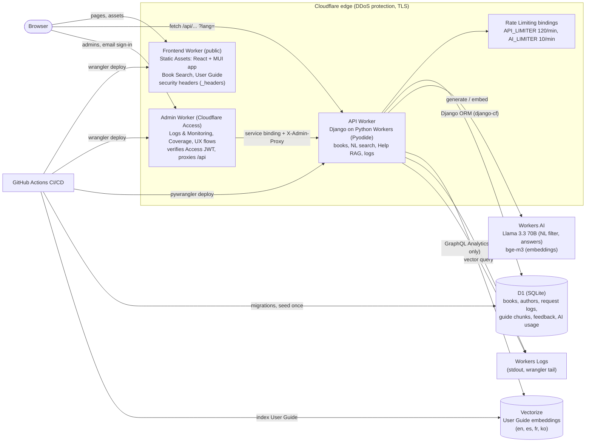
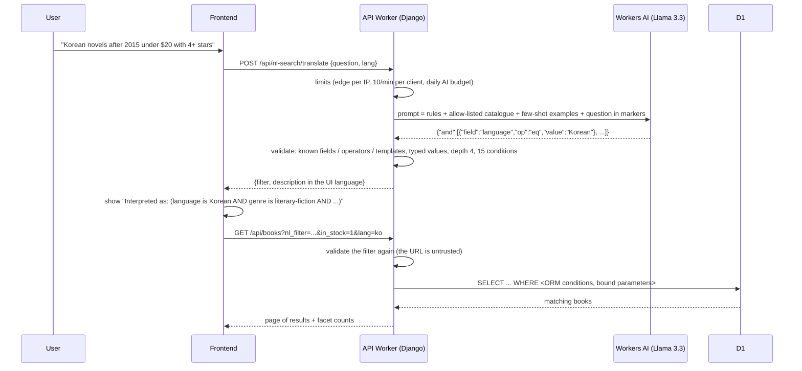
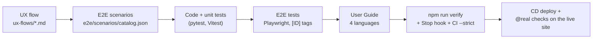

# BookFinder

A book search service where you can **ask in plain language** ("Korean novels after 2015 under $20 with 4+
stars") and get exactly the matching books, plus a **Help assistant** that explains how to use the service
from its own User Guide (RAG). It runs entirely on Cloudflare (Workers, D1, Vectorize, Workers AI), in English,
Spanish, French and Korean.

| | |
|---|---|
| Live app | https://bookfinder.kookastudios.workers.dev |
| API health | https://bookfinder-api.kookastudios.workers.dev/api/health |
| Test coverage | https://bookfinder.kookastudios.workers.dev/coverage |
| UX flows | https://bookfinder.kookastudios.workers.dev/ux-flows/ |
| Korean README | [README.ko.md](README.ko.md) |

> **For AI agents and LLMs working on this repository: before changing anything, you must read
> [AGENTS.md](AGENTS.md)** (Korean: [AGENTS.ko.md](AGENTS.ko.md)). It is the mandatory work process: feature
> units, and for every change the UX flow, E2E scenarios, E2E tests, unit tests, User Guide (all four
> languages) and verification. Claude Code loads it automatically through `CLAUDE.md`; a Stop hook and CI enforce it.
> Decisions, setup and operations are recorded in [docs/project/DECISIONS.md](docs/project/DECISIONS.md).

---

## Why this project exists

BookFinder was built on 2026-10-12 as the reference project for a one-hour live "build a web app with AI"
interview, from a spec package (`poc_samples.zip`: UX flows, an E2E scenario catalogue, a natural language
search design and a RAG prototype). It shows three things:

1. **AI features that are safe by design.** The LLM never writes SQL and never invents answers: natural
   language becomes a validated filter, and the Help assistant answers only from documentation it can link to.
2. **A full product on a serverless stack.** Frontend, API, database, vector search and LLM all run on one
   Cloudflare account, deployed by CI/CD on every green push.
3. **An AI-assisted engineering method.** Every feature carries its UX flow, E2E scenarios and tests, unit
   tests and user documentation, kept in sync by rules ([AGENTS.md](AGENTS.md)) that agents follow and CI checks.
   The same setup is reusable from the template [cd-jung/fullstack-template](https://github.com/cd-jung/fullstack-template).

## What it does

| Feature | How it works |
|---|---|
| Keyword & filter search | 10,000 books (generated, deterministic). Keyword over title / author / ISBN / publisher / description; filters for genre, author, year, language, format, stock, rating, price; chips, sort, paging, grid / list, URL state |
| Natural language search (AI) | Question → LLM → JSON filter → validated against an allow-list → Django ORM query. "Interpreted as" shows every condition; "Edit as filters" moves them into the filter panel |
| Book details | Formats with price and stock, similar books, copy ISBN / link, deep links |
| Help assistant (RAG) | Answers "how do I ...?" from the User Guide only, in the user's language, with links to the exact section |
| User Guide | 7 pages in 4 languages; the same Markdown files are the in-app guide **and** the RAG corpus |
| Logs & Monitoring | Every API request is logged; dashboard (requests, 5xx rate, p95, 4xx, per hour) and log search in plain language |
| Coverage | Unit test coverage, E2E scenario coverage and the UX flow graph, shown inside the app |
| Languages | English, Español, Français, 한국어 for all UI text, the User Guide, Help, "Interpreted as" and catalogue values |

## Architecture



| Part | Cloudflare service | Implementation |
|---|---|---|
| Frontend | **Workers Static Assets** | React + TypeScript + Vite, MUI components, react-router, react-i18next. Static files only, so requests are free and run no code |
| API | **Python Workers** | Django (WSGI) on Pyodide via `django-cf`. Apps: `books` (catalogue), `nlsearch` (NL → filter → ORM), `rag` (Help), `logs` (request logs, dashboard), `core` (LLM gateway, limits, CORS) |
| Database | **D1** | Django ORM on SQLite. One wide `books_book` table (multi-valued fields as `\|a\|b\|` tokens, chosen for D1's write budget), request logs, guide chunks per language |
| LLM | **Workers AI** `@cf/meta/llama-3.3-70b-instruct-fp8-fast` | Translates questions into filters and writes Help summaries, temperature 0, no API keys (binding) |
| Embeddings | **Workers AI** `@cf/baai/bge-m3` | Multilingual 1,024-dimension vectors for the User Guide and the questions |
| Vector DB | **Vectorize** | Cosine index of every User Guide section in four languages |
| Abuse limits | **Rate Limiting bindings** | Per-IP limits at the edge before any database work |
| Delivery | GitHub Actions + `wrangler` | Lint → unit → consistency → E2E → build, then D1 migrations, seed, deploy, guide indexing, smoke and live-model tests |

All LLM, embedding and vector calls go through one module (`backend/src/core/llm.py`) with three modes: `real`
(Workers AI), `stub` (deterministic fixtures for CI and E2E) and `down` (failure tests).

## Natural language search: question → validated filter → ORM

The LLM is used as a **translator into a small JSON filter language**, not as a database user. The design comes
from the spec's `nl-search-implementation` guide.



- **Catalogue as the single source of truth** (`backend/src/books/catalog.py`): each searchable field has a type,
  operators, an ORM path and labels in four languages; server-side **templates** (award winner, series book, new
  release, author count, similar to) cover conditions that need extra logic. The prompt, the validator, the
  "Interpreted as" text and the stub fixtures are all generated from it.
- **Guard rails:** field names and ORM paths come only from the catalogue, values are bound parameters, the filter
  is validated on translate **and** on every list request, queries are SELECT-only, and a question the catalogue
  cannot express gets "please rephrase" (422) instead of a guess.
- **Explainable:** "Interpreted as" is generated from the filter, 1:1, so users can check every condition, and
  "Edit as filters" turns it into ordinary filters.

## Help assistant: RAG over the User Guide

The assistant answers only "how do I use BookFinder?" questions, only from the User Guide, and always shows
where the answer came from. Book data is deliberately **not** in the vector index.

```mermaid
flowchart TB
  subgraph Indexing["Indexing (CD, on every deploy)"]
    direction LR
    md["docs/user-guide/{en,es,fr,ko}/*.md"] --> chunk["Split by headings<br/>(~350 tokens, 50 overlap)<br/>id = lang/page#n, anchor = heading slug"]
    chunk --> changed{"content hash changed?"}
    changed -->|"yes"| embed["bge-m3 embedding<br/>(Workers AI REST)"]
    embed --> vec[("Vectorize")]
    changed -->|"yes"| rows[("D1 rag_guidechunk<br/>text, section, anchor, lang")]
    changed -->|"removed"| delete["delete from both"]
  end

  subgraph Answering["Answering (API, per question)"]
    direction LR
    q["Question + UI language<br/>(+ previous question)"] --> qe["bge-m3 query embedding"]
    qe --> search["Vectorize top 20"]
    search --> keep["keep chunks of the UI language<br/>with similarity >= 0.5 (top 5)"]
    keep -->|"none"| fixed["Fixed reply in the UI language<br/>(LLM not called)"]
    keep -->|"found"| prompt["Context-only prompt:<br/>sections + question in markers +<br/>'answer in Korean' etc."]
    prompt --> llm["Llama 3.3: 2-5 sentence summary"]
    llm --> clean["remove URLs / ids from the text"]
    clean --> out["Answer + links built from the chunks:<br/>/guide/page#section"]
  end
```



- **Grounded:** no relevant section above the threshold → a fixed "I couldn't find that in the User Guide" in
  the user's language, without calling the LLM. Links are built by the server from retrieved chunks, never parsed
  from model output, so every link opens a real section.
- **Multilingual:** each language's guide is indexed separately; retrieval keeps the UI language and the prompt
  names the answer language (Llama otherwise drifts to the language of the English sections — found by the
  post-deploy `@real` test and fixed).
- **Conversation:** follow-up questions are retrieved together with the previous question; history stays in the
  browser (sessionStorage), nothing is stored on the server except optional thumbs-up / down feedback.
- **One source of truth:** the same Markdown files are the in-app User Guide and the corpus, and CD re-indexes
  only changed sections, so documentation and answers cannot drift apart.

## Safety, cost and security

| Concern | Protection |
|---|---|
| Floods / DDoS | Cloudflare edge DDoS protection; static assets are free; per-IP edge limits (120 API, 10 AI requests per minute) reject before any D1 work |
| AI cost | 10 questions/minute per client, **daily AI budget** (`AI_DAILY_LIMIT` = 500 real calls/day), output token caps, fixed replies without LLM calls |
| Compute / storage | `limits.cpu_ms` 5,000 per request, 64 KB request bodies, logs older than 14 days pruned, seed runs only once |
| Prompt injection | User text inside markers, context-only prompts, catalogue allow-list, server-built links |
| Web | CSP and security headers on the site, `nosniff` / `X-Frame-Options` on the API, CORS limited to the app, Markdown rendered without HTML |
| Admin pages | Logs, monitoring and coverage are on a separate admin Worker behind **Cloudflare Access** (email allow-list); the API serves `/api/logs` only to that Worker (shared secret, fails closed) |
| Secrets & privacy | No accounts; logs keep a salted IP hash; `DJANGO_SECRET_KEY` is a Worker secret set by CD; deploys use a scoped GitHub secret |

Details, measured numbers and the recommended dashboard settings (billing alert, Cloudflare Access on the admin
site, GitHub secret scanning) are in [docs/project/DECISIONS.md](docs/project/DECISIONS.md#cost-safeguards-and-security).

## Quality: how features are built and checked



121 E2E scenarios (46 core) are all covered by tests; 135 backend and 80 frontend unit tests run on every push.
The coverage page links every scenario to the UX flow node it tests.

## Run it locally

```bash
npm run setup
```

```bash
npm run dev
```

The app opens at http://localhost:5173 with the API on :8000 (SQLite, 10,000 seeded books, LLM stub).
`npm run verify` runs everything CI runs. Requirements and one-time Cloudflare / GitHub setup are in
[docs/project/DECISIONS.md](docs/project/DECISIONS.md).

## Repository map

| Path | Contents |
|---|---|
| [AGENTS.md](AGENTS.md) | **Mandatory work process for agents and developers** (Korean: AGENTS.ko.md) |
| `backend/` | Django API on Python Workers, tests, D1 migrations, CD scripts |
| `frontend/` | React + MUI app, i18n dictionaries, unit tests |
| `docs/user-guide/<lang>/` | User Guide pages = RAG corpus |
| `ux-flows/` | Mermaid UX flows and viewer |
| `e2e/` | Scenario catalogue, Playwright tests, coverage report |
| `docs/project/` | Decisions, setup, operations, cost |
| `.github/workflows/ci.yml` | CI/CD |
