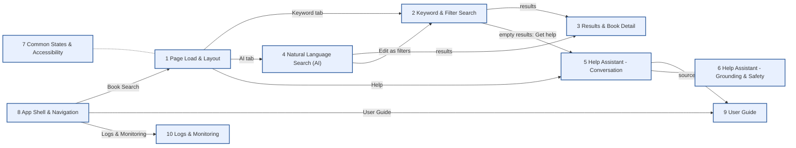

# 0. Overview - Scenario Map

BookFinder (fictional): book search with keyword & filter search, natural language (AI) search, a Help
assistant that explains how to use the service (RAG over the User Guide), the User Guide itself and
Logs & Monitoring. No login. Click a box to open its flow.

