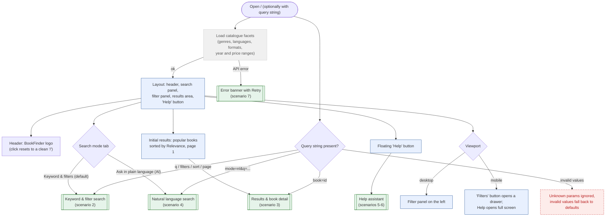

# 1. Page Load & Layout

BookFinder is a fictional book search service. No login. The search is the Book Search page (`/`)
inside the app shell (scenario 8).
URL query keeps the state: `mode`, `q`, filters, `sort`, `page`, `book`.

