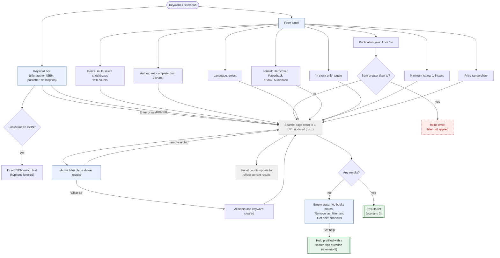

# 2. Keyword & Filter Search

Keyword box searches title, author, ISBN, publisher and description. Filters combine with AND
(values inside one multi-select filter combine with OR). Every change refetches and updates the URL.

