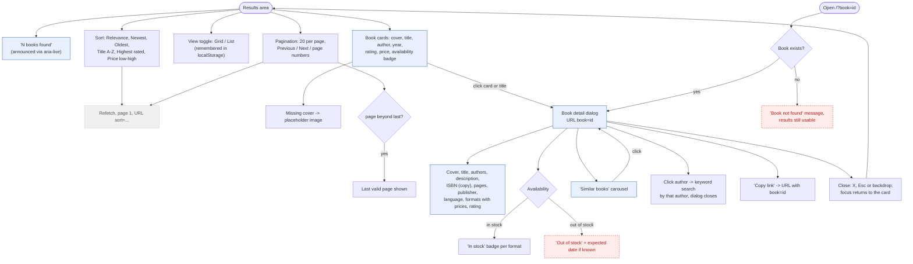

# 3. Results & Book Detail

Results are shared by keyword, filter and natural language search. The Help assistant only explains how
to use the service, so the original "Ask about this book" action is not part of BookFinder.

