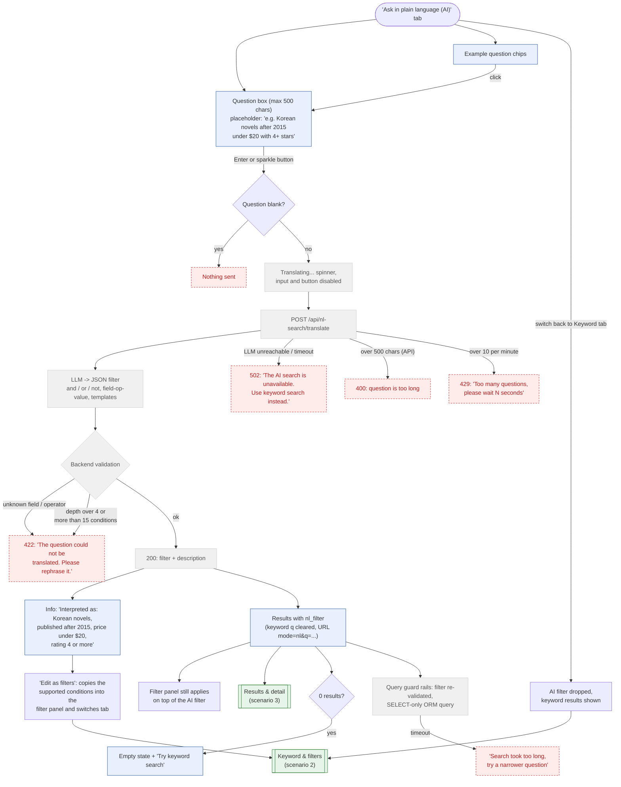

# 4. Natural Language Search (AI)

Same design as the MEDS natural language PoC (`poc/nl-asset-search`): the question is sent to a
translate endpoint, an LLM turns it into a JSON filter, the backend validates it against an allow-list
catalogue and returns the filter plus a human-readable description. The results list then runs with
that filter (SELECT-only ORM query; on D1 there is no Postgres read-only transaction or statement timeout). The LLM never writes SQL and never sees book data.

