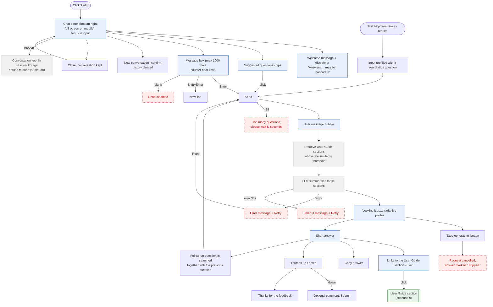

# 5. Help Assistant - Conversation

The Help assistant explains how to use BookFinder. Each question is embedded, the most similar User Guide
sections are retrieved from Vectorize, and the LLM writes a short summary from those sections only, with
links to them. It does not answer questions about individual books (that is what the search is for).
Grounding and safety rules are in scenario 6. Adapted from the original "Ask the librarian" catalogue chatbot.

