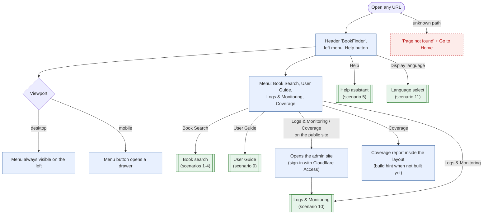

# 8. App Shell & Navigation

Every page shares the header (BookFinder; clicking it opens a clean search), the left menu and the
floating Help button. The public site serves Book Search and the User Guide; Logs & Monitoring and
Coverage are on the admin site, so on the public site those entries open the admin site.

